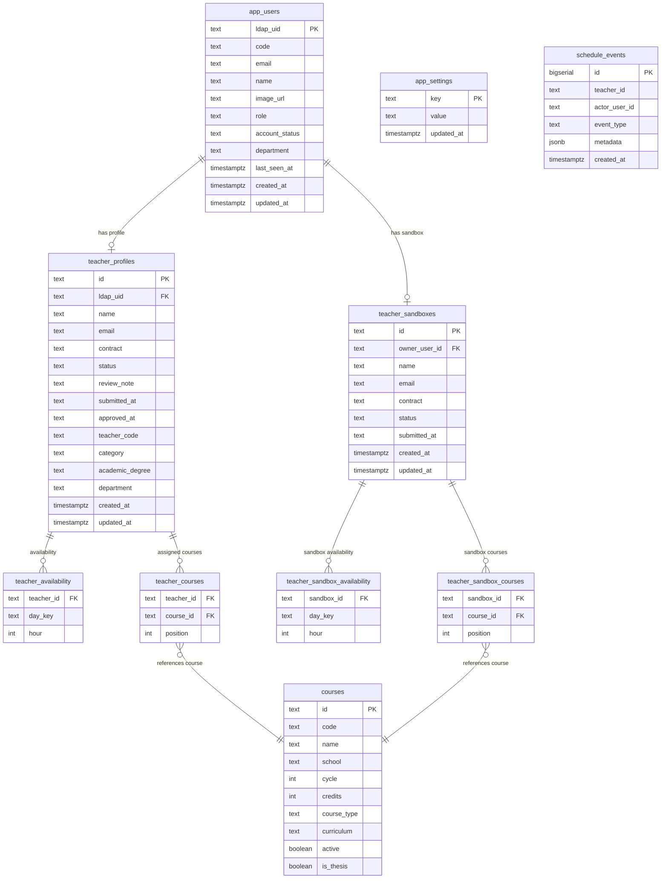

# Data Model

Source of truth: `src/lib/data/schedule-db.ts`, function `ensureScheduleSchema()`.
Database engine: PostgreSQL v18.
Identity provider: Keycloak 26.8.2 (integrated with OpenLDAP).

## Entity-relationship diagram



---

## Conceptual Clarification: Escuela vs Departamento

In the Faculty of Systems Engineering and Informatics (FISI - UNMSM), **Escuela** and **Departamento** represent two distinct institutional entities:

1. **Escuela Profesional (`school`)**:
   - Represents the academic school / undergraduate degree program managing the study plans and courses.
   - Assigned to catalog courses (`courses.school`).
   - Official School Codes:
     - `EPIS`: Escuela Profesional de Ingeniería de Sistemas
     - `EPISW`: Escuela Profesional de Ingeniería de Software
     - `EPCC`: Escuela Profesional de Ciencia de la Computación
     - `EPIA`: Escuela Profesional de Ingeniería de Inteligencia Artificial
     - `Transversal`: Common or transversal courses across engineering degrees
2. **Departamento Académico (`department`)**:
   - Represents the faculty organization of professors and teachers.
   - Associated with authenticated users (`app_users.department`) and teacher profiles (`teacher_profiles.department`).
   - Official Department Codes:
     - `SW`: Departamento Académico de Ingeniería de Software (e.g., DAISW)
     - `CC`: Departamento Académico de Ciencias de la Computación
     - `NA`: Not Applicable (default assignment for administrative roles: `admin` and `direccion`)

---

## Table dictionary

### app_users

Synchronized Just-In-Time (JIT) during authentication with Keycloak OIDC / OpenLDAP. Each row represents an institutional identity with access to the system.

| Column | Type | Constraints | Description |
|---|---|---|---|
| `ldap_uid` | text | PK | LDAP UID / Keycloak `preferred_username` (e.g. `hpaucarc`, `daisw.fisi`) |
| `code` | text | NOT NULL, default `''` | Institutional teacher/faculty code (e.g. `0A5292`, `ADMIN`, `DIRECCION`) |
| `email` | text | NOT NULL | Institutional email in lowercase (`@unmsm.edu.pe`) |
| `name` | text | NOT NULL | Full name of the user |
| `image_url` | text | NOT NULL, default `''` | Avatar or profile picture URL |
| `role` | text | NOT NULL, default `'docente'`, CHECK (`docente`, `direccion`, `admin`) | Application effective role |
| `account_status` | text | NOT NULL, default `'ACTIVO'` | Account status (`ACTIVO`, etc.) |
| `department` | text | NOT NULL, default `'NA'`, CHECK (`SW`, `CC`, `NA`) | Academic department of the teacher (`SW`, `CC`, or `NA` for direction/admin) |
| `last_seen_at` | timestamptz | nullable | Timestamp of the last user login/activity |
| `created_at` | timestamptz | NOT NULL, default `now()` | Record creation timestamp |
| `updated_at` | timestamptz | NOT NULL, default `now()` | Record last update timestamp |

### teacher_profiles

Official availability and schedule submission profile for each faculty member. A teacher has at most one official profile.

| Column | Type | Constraints | Description |
|---|---|---|---|
| `id` | text | PK | Profile identifier (unique slug or teacher identifier) |
| `ldap_uid` | text | UNIQUE, FK -> `app_users.ldap_uid`, ON DELETE SET NULL | Linked LDAP user |
| `name` | text | NOT NULL | Full name of the teacher |
| `email` | text | NOT NULL | Institutional email address |
| `contract` | text | NOT NULL, CHECK (`full`, `partial20`, `partial10`) | Contract classification |
| `status` | text | NOT NULL, default `'borrador'`, CHECK | Profile status (see Lifecycle below) |
| `review_note` | text | NOT NULL, default `''` | Observation note written by Direction when status is `'observado'` |
| `submitted_at` | text | nullable | Submission timestamp string |
| `approved_at` | text | nullable | Approval timestamp string |
| `teacher_code` | text | nullable | Institutional teacher code, synchronized with `app_users.code` |
| `category` | text | nullable | Academic category (pending institutional review) |
| `academic_degree` | text | nullable | Highest academic degree (pending institutional review) |
| `department` | text | nullable, CHECK (`SW`, `CC`, `NA` or `null`) | Academic department, synchronized with `app_users.department` |
| `created_at` | timestamptz | NOT NULL, default `now()` | Record creation timestamp |
| `updated_at` | timestamptz | NOT NULL, default `now()` | Record last update timestamp |

### courses

Official course catalog offered by the academic schools (`EPIS`, `EPISW`, `EPCC`, `EPIA`, `Transversal`). Managed by users with `admin` role.

| Column | Type | Constraints | Description |
|---|---|---|---|
| `id` | text | PK | Course slug identifier (e.g. `episw-desarrollo-de-software-i`) |
| `code` | text | nullable | Curricular syllabus course code |
| `name` | text | NOT NULL | Course title |
| `school` | text | NOT NULL | Professional school offering the course (`EPIS`, `EPISW`, `EPCC`, `EPIA`, `Transversal`) |
| `cycle` | int | nullable | Curricular semester cycle (1 to 10) |
| `credits` | int | nullable | Academic credits |
| `course_type` | text | nullable | Course classification (e.g. Obligatorio, Electivo) |
| `curriculum` | text | nullable | Curriculum study plan version (e.g. 2018) |
| `active` | boolean | NOT NULL, default `true` | Whether the course is active in the current term |
| `is_thesis` | boolean | NOT NULL, default `false` | Thesis course flag (exempt from per-contract maximum course count) |

### teacher_availability

Selected hourly time slots declared by the teacher. Each row represents a 1-hour availability slot on a given weekday.

| Column | Type | Constraints | Description |
|---|---|---|---|
| `teacher_id` | text | PK (composite), FK -> `teacher_profiles.id`, ON DELETE CASCADE | Associated teacher profile |
| `day_key` | text | PK (composite) | Weekday: `lunes`, `martes`, `miercoles`, `jueves`, `viernes`, `sabado` |
| `hour` | int | PK (composite) | Hour slot (integer 8 through 21 representing 08:00 to 22:00) |

### teacher_courses

Courses selected by the teacher for availability assignment.

| Column | Type | Constraints | Description |
|---|---|---|---|
| `teacher_id` | text | PK (composite), FK -> `teacher_profiles.id`, ON DELETE CASCADE | Associated teacher profile |
| `course_id` | text | PK (composite), FK -> `courses.id`, ON DELETE RESTRICT | Selected catalog course |
| `position` | int | NOT NULL, default `0` | Order of preference/display |

### app_settings

Global application configuration and term status in key-value format.

| Column | Type | Constraints | Description |
|---|---|---|---|
| `key` | text | PK | Configuration parameter key (e.g. `academic_term`, `period_closed`, `period_closed_at`) |
| `value` | text | NOT NULL | Configuration parameter text value |
| `updated_at` | timestamptz | NOT NULL, default `now()` | Timestamp of last setting modification |

### schedule_events

Audit trail and event log for critical schedule state changes and administrative actions.

| Column | Type | Constraints | Description |
|---|---|---|---|
| `id` | bigserial | PK | Sequential event log identifier |
| `teacher_id` | text | NOT NULL | Target teacher identifier |
| `actor_user_id` | text | NOT NULL | User who executed the action (`ldap_uid`) |
| `event_type` | text | NOT NULL | Action type (e.g. `teacher.submitted_schedule`, `director.approved_schedule`, `director.observed_schedule`, `teacher.requested_reopen`, `director.authorized_reopen`) |
| `metadata` | jsonb | NOT NULL, default `'{}'::jsonb` | Contextual event details (timestamps, notes, payload summary) |
| `created_at` | timestamptz | NOT NULL, default `now()` | Event record timestamp |

### teacher_sandboxes

Simulation workspace for users with `admin` or `direccion` roles to test availability submission without tampering with real faculty records.

| Column | Type | Constraints | Description |
|---|---|---|---|
| `id` | text | PK | Sandbox profile identifier (`sandbox:<ldap_uid>`) |
| `owner_user_id` | text | UNIQUE, FK -> `app_users.ldap_uid`, ON DELETE CASCADE | Owning administrator or director |
| `name` | text | NOT NULL | Simulated teacher name |
| `email` | text | NOT NULL | Simulated teacher email |
| `contract` | text | NOT NULL, CHECK (`full`, `partial20`, `partial10`) | Simulated contract type |
| `status` | text | NOT NULL, default `'borrador'`, CHECK | Lifecycle status matching `teacher_profiles.status` |
| `submitted_at` | text | nullable | Submission timestamp |
| `created_at` | timestamptz | NOT NULL, default `now()` | Creation timestamp |
| `updated_at` | timestamptz | NOT NULL, default `now()` | Last update timestamp |

### teacher_sandbox_availability & teacher_sandbox_courses

Child tables of `teacher_sandboxes` mirroring `teacher_availability` and `teacher_courses` respectively, scoped to the test sandbox workspace.

---

## Invariants and Business Rules

### Teacher Profile Lifecycle

The schedule status transitions through the following state machine:

```
                  +---------------------------+
                  |                           |
                  v                           | (authorize reopen)
[borrador] <-------------> [observado]        |
    |          (observe)       ^              |
    | (submit)                 | (observe)    |
    v                          |              |
[enviado] ---------------------+              |
    |                                         |
    | (approve)                               |
    v                                         |
[aprobado] -----------------------------------+
    |                   ^
    | (request reopen)  | (reject / cancel)
    v                   |
[solicitud_reapertura] -+
```

1. **`borrador`**: Teacher is actively drafting courses and availability slots.
2. **`enviado`**: Teacher submitted availability and is awaiting departmental review.
3. **`observado`**: Direction observed defects; `review_note` contains actionable feedback. Teacher can edit and resubmit.
4. **`aprobado`**: Department direction approved the submission. Schedule is sealed.
5. **`solicitud_reapertura`**: Teacher requests the department direction to reopen an approved or submitted schedule for amendments.

### Contract Types and Load Rules

Defined in `src/lib/domain/schedule-data.ts`:

| Contract Type | Key | Total Hours | Daily Max | 4h Block Size | Required Block Days | Max Courses (excl. thesis) |
|---|---|---|---|---|---|---|
| Tiempo Completo (TC) | `full` | 40 | 8 | 4 | 5 | 3 |
| Tiempo Parcial 20h (TP20) | `partial20` | 20 | 4 | 4 | 5 | 2 |
| Tiempo Parcial 10h (TP10) | `partial10` | 12 | 4 | 4 | 3 | 1 |

- Courses with `is_thesis = true` are exempt from the maximum course limit.

### Period-Open Gate

All mutations to teacher availability, courses, or statuses call `ensurePeriodOpen()`. If `app_settings.period_closed` is `'true'`, all editing actions are blocked with HTTP 403 until reopened by an administrator.
